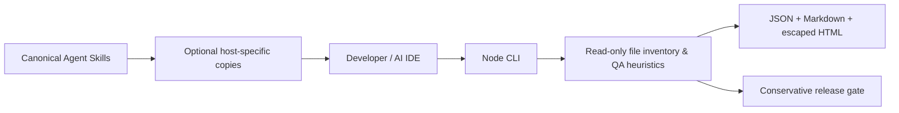

# Starter architecture

The CLI is deterministic and has no model API dependency. The host IDE reads `SKILL.md` files to provide AI interpretation. There is no covert bridge into IDE model inference. Runtime test execution requires a separate approved runner not present in this starter.

Trust: source files being scanned are untrusted; symlinks are skipped; file size/count are bounded. Reports are written only to explicit `--out` and may contain paths; review before sharing. The gate cannot issue GO in this starter because no executed-test evidence is obtained. See `docs/master-claude-prompt.md` for intended domain contracts.
