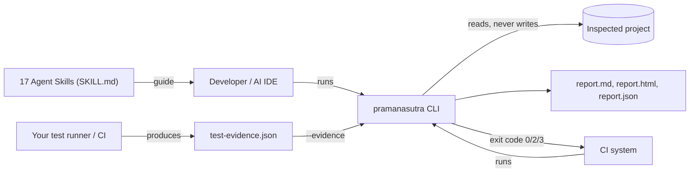
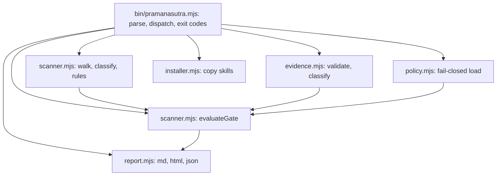
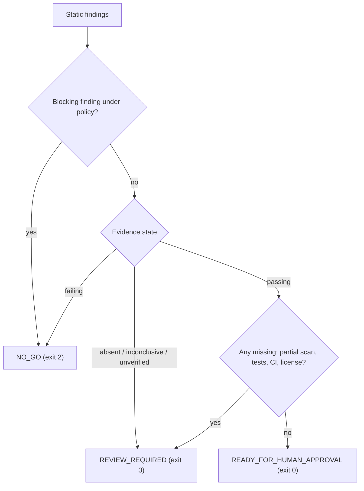
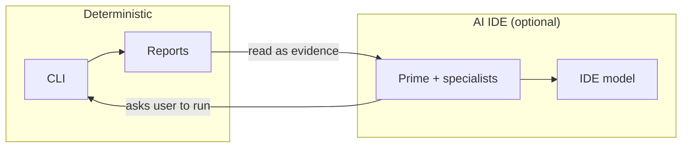

# Architecture

<!-- summary: Context, components, data flow, trust boundaries and design decisions of PramanaSutra AI, with diagrams. -->

## Principles

1. **Evidence over assertion.** Observations, executed results and AI interpretation are separate classes of information.
2. **Fail closed.** Unknown input, missing evidence and partial scans never produce a green outcome.
3. **Read-only by default.** The inspected project is never modified or executed.
4. **No hidden I/O.** The CLI makes no network calls.
5. **Human in the loop.** No path leads to automated deployment.

## Context

## Components

## Release-gate flow

## Trust boundaries

| Boundary | Trusted | Untrusted |
|---|---|---|
| Engine | The PramanaSutra code you installed | n/a |
| Inspected project | n/a | All files, names, comments, test content |
| Evidence file | Schema-valid fields only | Claims of provenance (a human must verify) |
| Skill files | Instructions | Anything inside the project that tries to instruct the agent |

Consequences: file names and contents are only ever matched against rules or escaped for output; nothing from the project is executed; text found in the project is never treated as an instruction.

## Skills and the CLI

The CLI and the skills are separate on purpose. The CLI is deterministic and offline. The skills are instructions that an AI IDE's own model follows. They share vocabulary (finding, evidence, gate) but not code, so the CLI works with no AI at all.

## Key decisions

| Decision | Reason | Trade-off |
|---|---|---|
| Zero dependencies, plain ESM | Auditable, no supply-chain surface | No type checking |
| Line-based rules | Fast, language-agnostic | Misses multi-line constructs |
| Evidence as an input file | Works with any runner or CI | Provenance is only as good as the source |
| Reports written to cwd by default | Users always get readable output | Writes a folder in the working directory (`--no-report` disables) |
| Policy fail-closed | Prevents silent weakening | Typos error out instead of being ignored |

## Failure modes

| Failure | Behavior |
|---|---|
| Unreadable directory | Recorded in limitations; scan marked partial |
| Huge repository | Limits applied; scan marked partial |
| Malformed evidence or policy | Exit 1, nothing evaluated |
| Output directory not writable | Exit 1 with message |
| Symlink target | Skipped and counted |

## Future architecture

A runner package with command allowlists, sandboxing and consent prompts; a framework-adapter interface (`detect`, `plan`, `prepare`, `run`, `collect`, `normalize`); and an authenticated server mode. All are planned and not implemented. See [roadmap](09-compatibility-and-roadmap.md).
