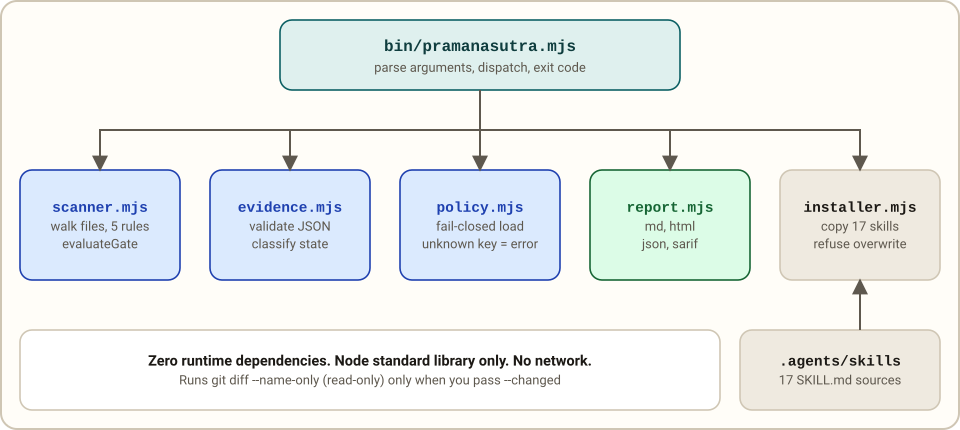
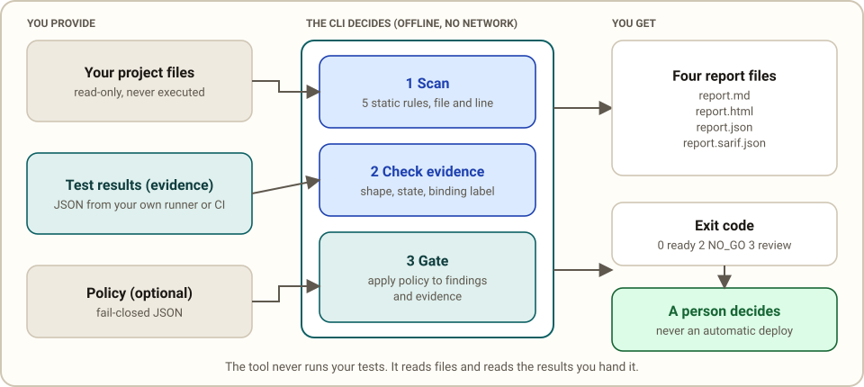
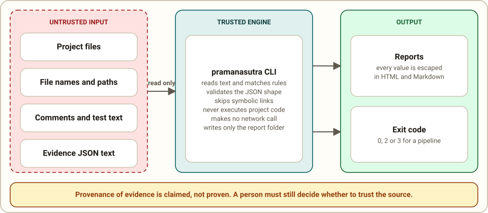

# Architecture

<!-- summary: Components, data flow, trust boundaries and design decisions for the PramanaSutra AI CLI and skills. The CLI does not call a model and does not run the target's tests. -->

## What exists at runtime

There is one program: `packages/cli/bin/pramanasutra.mjs`. It loads four libraries and nothing else. There is no database, no daemon, no plugin loader and no network stack in the scan path.

The diagrams are plain SVG files. The page does not fetch a chart library. One scan writes `report.md`, `report.html`, `report.json` and `report.sarif.json` (SARIF 2.1.0).

## Trust boundaries

| Boundary | Rule |
|---|---|
| Target tree to scanner | Read-only. Symlinks skipped, not followed. Directories in the skip list (`.git`, `node_modules`, build outputs, `pramanasutra-reports`) are not entered |
| Ignore file to scanner | Prefixes only. `..`, absolute paths and NUL are rejected. The file is data, not code |
| Evidence file to gate | Schema-checked JSON, max 1 MB, must be a regular file. The counts are believed as data. The provenance is only as good as `source` |
| Policy file to gate | Fail closed. Safety flags cannot be weakened |
| Report to the reader | Every string that came from the repo or the evidence file is escaped in HTML and in Markdown |
| IDE to skill | The skill is text. The model is the IDE's. PramanaSutra does not see that traffic |
| CLI to network | No HTTP client is used by the scan, gate, report or installer |

## Command flow

`scan` calls `scanProject`, runs `evaluateGate` with no evidence (so the decision is at best `REVIEW_REQUIRED` unless something is already `NO_GO`), and writes reports. Exit code is 0 even when the gate is not ready, because scan is an inspection.

`release-check` is the same pipeline plus optional evidence and policy. Its exit code is the gate: 2, 3 or 0. That is the code CI should use.

`verify` only validates an evidence file. It does not scan.

`init` only copies directories.

## Design decisions

**Heuristics, not parsers.** A real parser for every language would be a different product and a large dependency. The cost is false positives and false negatives. Each rule says its confidence is `medium` except the license check, which is `high` because it is a file-name check. The report repeats the limitation so a green gate is not read as a proof of absence.

**Evidence is supplied, not collected by running tests.** Running the target's test script would execute arbitrary code. The CLI refuses that. CI runs the tests in its own job, where the user already accepted that risk, and passes the summary in.

**Ready still needs a human.** `requiresHumanApproval` is always true. `automatedDeploymentAuthorized` is always false. A policy cannot flip them.

**Reports are the product, not a log line.** Reviewers live in pull requests and browsers. Markdown, HTML and JSON are written in one function so they cannot drift into different facts. JSON is the machine copy of the same object the prose describes.

**Ignore is visible.** Hiding `fixtures/` without saying so would make this repository's own gate dishonest. The limitation line is mandatory when the ignore file matches anything.

## What the other packages are

Directories under `packages/` other than `cli` (`core`, `runner`, `server`, `reporter`, and the rest) contain README notes for planned modules. They are not imported by the CLI. Treat them as roadmap, not as running code. The status page says the same thing. Do not document them as features.

## Failure behavior

| Condition | Result |
|---|---|
| Path missing, not a directory, or a symlink | Error, exit 1 |
| Evidence or policy unreadable, huge, or schema-invalid | Error, exit 1 |
| Unreadable subdirectory during the walk | Limitation on the report, scan continues, `inventory.partial` may be true, gate will not be ready |
| More than 20,000 files or depth 22 | Truncation limitation, partial scan, not ready |
| Test file bigger than 2,000,000 bytes | Skipped, partial, not ready |
| Test file contains a NUL | Skipped as binary, partial, not ready |
| Output directory cannot be created | Error, exit 1 |

## Extension points

A new static rule belongs in `scanner.mjs` next to the existing ones, with a fixture and a test. A new evidence source belongs in `evidence.mjs` and must not be added to the "can count as passing" set unless the provenance story is real. A new IDE path belongs in `installer.mjs` `ADAPTERS`. None of these load remote code.
