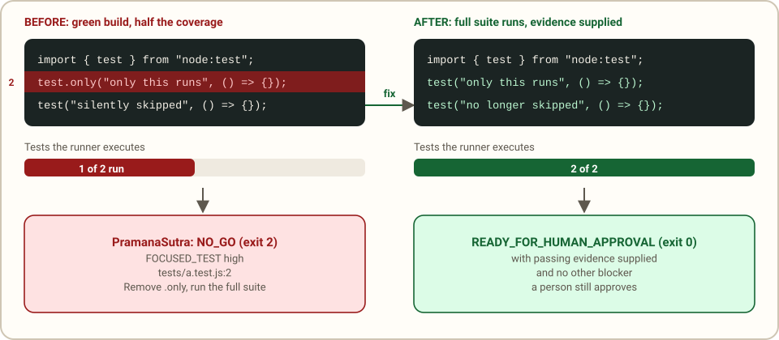
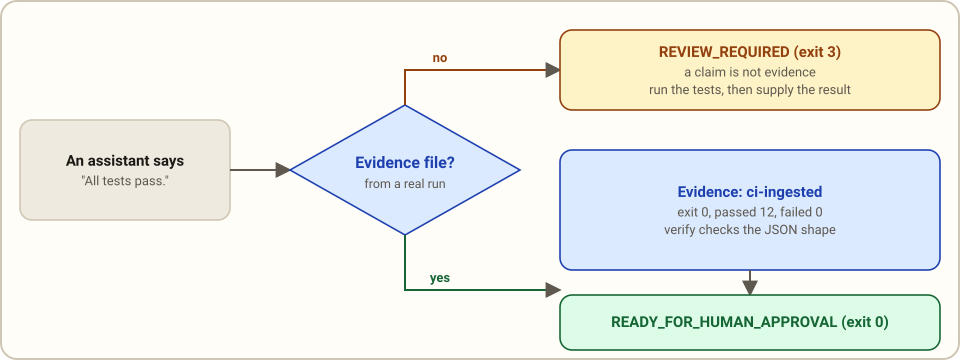
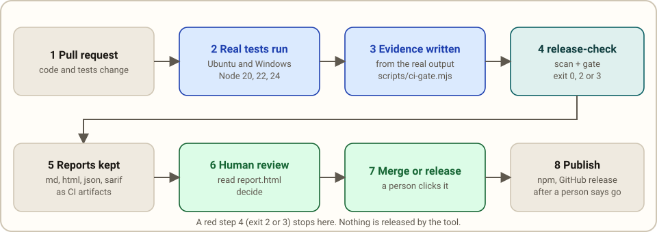
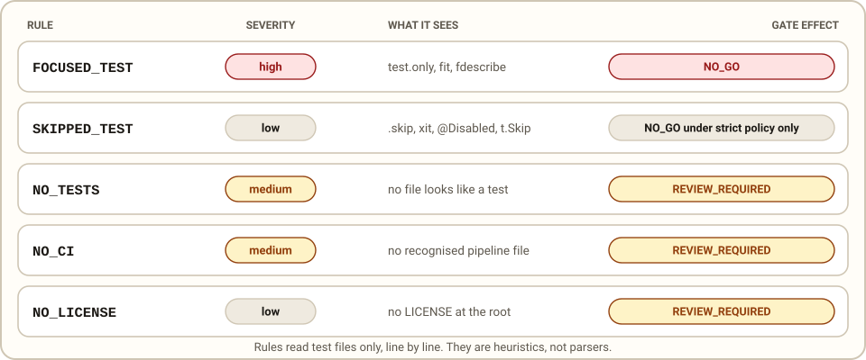
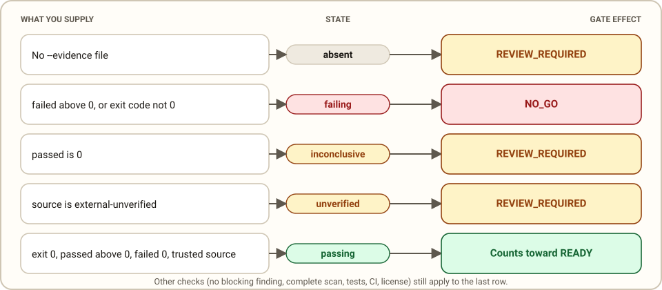
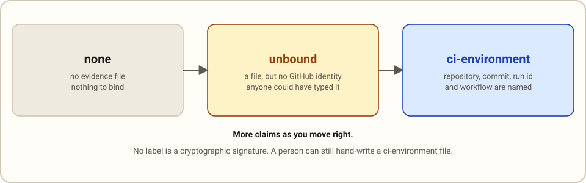
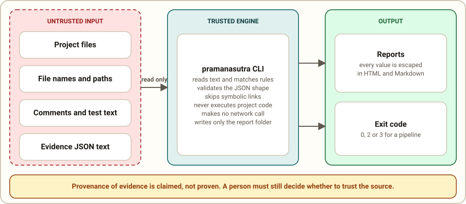
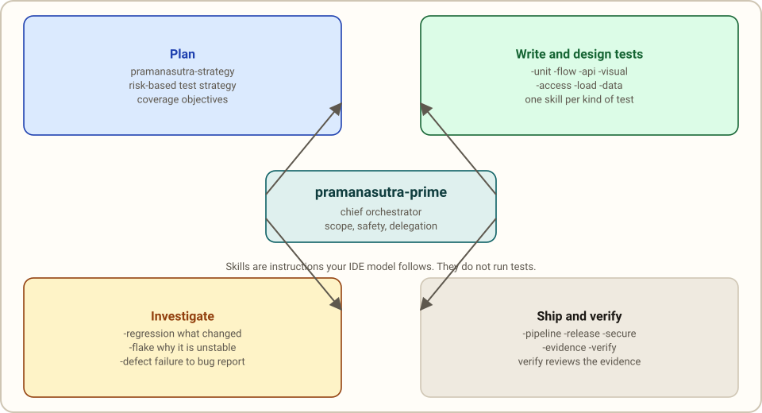
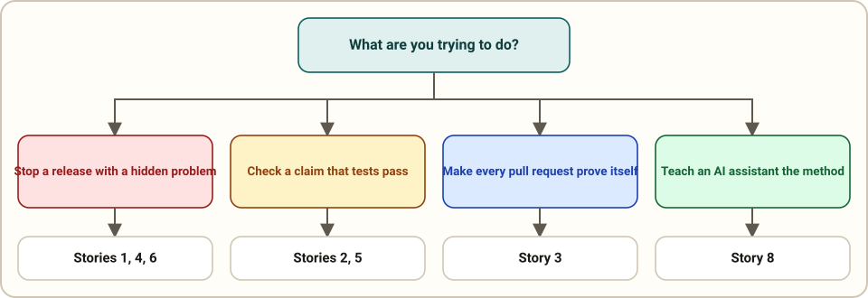

# Real-world scenarios

<!-- summary: Eight true-to-life situations where PramanaSutra AI helps, each with the exact commands, the real terminal output captured from this repository's fixtures, and what to do next. -->

Every command on this page was run against a committed project in `fixtures/` of this repository. The terminal output is copied, not written by hand. Where a picture helps, it is drawn from the same facts.

> **Note:** Nothing here runs your tests. In each story the tests are run by your own tool. PramanaSutra reads the project and reads the result you hand it.

## The eight stories at a glance

| # | Story | Who feels it | What PramanaSutra does |
|---|---|---|---|
| 1 | A stray `test.only` before Friday's release | Developer | Finds it by line and blocks with `NO_GO` |
| 2 | "The AI said all tests pass" | Tech lead | Refuses to treat a claim as evidence |
| 3 | The pull-request gate | Team | Fails the build with an exit code and a readable report |
| 4 | Skipped tests pile up | QA lead | Lists every skip in three languages, can block on them |
| 5 | The pasted "passing" JSON | Release manager | Labels how much the evidence can be trusted |
| 6 | A legacy service with no tests | New owner | Says plainly that nothing was found, not that it is fine |
| 7 | A repository with hostile file names | Security reviewer | Scans safely and escapes every name in the report |
| 8 | Teaching your AI IDE the method | Any developer | Installs 17 skills and shows the prompt to use |

## Story 1: the stray `test.only`

**The situation.** It is 16:40 on a Friday. A developer was debugging one test and typed `test.only`. The build is green because the runner now executes **one** test. Nobody notices.



**What you run.**

```bash
npx pramanasutra release-check --path fixtures/focused-test
```

**What you see.**

```text
PramanaSutra release-check: 4 file(s), 1 test file(s), 1 finding(s). Gate: NO_GO. Tests executed by this tool: NO. Evidence: absent.
exit=2
```

**What the report says** (`report.md`, trimmed):

```text
| high | `FOCUSED_TEST` | `tests/a.test.js:2` | Remove .only / fit / fdescribe, then execute the full suite. |
```

**What you do.** Delete `.only` on line 2, run your full suite, write the result to an evidence file, and run the check again. See [story 2](#story-2-the-ai-said-all-tests-pass) for that last step.

**Why it matters.** A focused test is the cheapest way to lose coverage without any alarm. The scanner reads the line, not the runner's summary, so it still sees the problem when the build is green.

## Story 2: "the AI said all tests pass"

**The situation.** An assistant summarised a pull request and wrote "all tests pass". There is no log. You need to know whether to believe it.



**Step 1: check the project without evidence.**

```bash
npx pramanasutra release-check --path fixtures/clean-project
```

```text
PramanaSutra release-check: 6 file(s), 1 test file(s), 0 finding(s). Gate: REVIEW_REQUIRED. Tests executed by this tool: NO. Evidence: absent.
exit=3
```

A clean project with no findings still stops at `REVIEW_REQUIRED`. The reason is in the report: *No executed-test evidence supplied.*

**Step 2: run the tests yourself, then describe the result.**

```json
{
  "schemaVersion": "1.0.0",
  "source": "ci-ingested",
  "command": "npm test",
  "executedAt": "2026-11-01T10:00:00Z",
  "exitCode": 0,
  "passed": 1,
  "failed": 0
}
```

```bash
npx pramanasutra verify --evidence evidence.json
npx pramanasutra release-check --path fixtures/clean-project --evidence fixtures/clean-project/evidence.json
```

```text
Evidence valid: source=ci-ingested, passed=1, failed=0, exitCode=0. Provenance is only as trustworthy as its source.
PramanaSutra release-check: 6 file(s), 1 test file(s), 0 finding(s). Gate: READY_FOR_HUMAN_APPROVAL. Tests executed by this tool: NO. Evidence: passing.
exit=0
```

**The lesson.** The first answer was `REVIEW_REQUIRED` for a project that really was fine. That is the design. Being right without proof does not count.

> **Important:** `READY_FOR_HUMAN_APPROVAL` is not a deploy order. The gate always records `requiresHumanApproval: true` and `automatedDeploymentAuthorized: false`.

## Story 3: the pull-request gate

**The situation.** Your team wants every pull request to prove its tests ran before a person reviews it.



This repository does exactly that. The `CI` workflow runs the real tests on Ubuntu and Windows with Node 20, 22 and 24. Then `scripts/ci-gate.mjs` reads the real test output, writes an evidence file, and runs `release-check` on the repository.

```yaml
- run: npm test
- name: Release gate on this repo, using the test run as evidence
  run: node scripts/ci-gate.mjs
```

On the latest run all six jobs passed. A red step means the process stopped there: exit 2 is a blocker, exit 3 is missing evidence. A person reads `report.html` and decides.

> **Tip:** Upload the `pramanasutra-reports` folder as a CI artifact so reviewers can open the HTML report from the pull request.

Read [CI and release](12-ci-and-release.md) for the full workflow and for why macOS is not on the required matrix.

## Story 4: skipped tests pile up

**The situation.** A polyglot repository has Python, Java and Go tests. Over the years people added skips "just for now".

```bash
npx pramanasutra release-check --path fixtures/multi-language
```

```text
PramanaSutra release-check: 3 file(s), 3 test file(s), 5 finding(s). Gate: REVIEW_REQUIRED. Tests executed by this tool: NO. Evidence: absent.
exit=3
```

Three of the five findings are skips, with exact locations:

| Rule | Where | What it saw |
|---|---|---|
| `SKIPPED_TEST` | `tests/test_api.py:3` | `@pytest.mark.skip(...)` |
| `SKIPPED_TEST` | `src/UserServiceTest.java:2` | `@Disabled` |
| `SKIPPED_TEST` | `pkg/b_test.go:3` | `t.Skip("later")` |

The other two are `NO_CI` and `NO_LICENSE`. By default skips only ask for review. If your team wants skips to stop a release, use the strict policy:

```bash
npx pramanasutra release-check --path fixtures/multi-language --policy policies/strict.json
```

```text
PramanaSutra release-check: 3 file(s), 3 test file(s), 5 finding(s). Gate: NO_GO. Tests executed by this tool: NO. Evidence: absent.
exit=2
```



## Story 5: the pasted "passing" JSON

**The situation.** Someone pastes a JSON file that says the tests passed. How much should you trust it?

The tool cannot prove the tests ran. It can refuse to over-trust. It gives the evidence a state and a binding label.



Two real examples against the same clean project:

```bash
# failures reported: exit code 1, 2 failed
npx pramanasutra release-check --path fixtures/clean-project --evidence fail.json
```

```text
Gate: NO_GO. Evidence: failing.
exit=2
```

```bash
# a file that admits its source is unverified
npx pramanasutra release-check --path fixtures/clean-project --evidence unverified.json
```

```text
Gate: REVIEW_REQUIRED. Evidence: unverified.
exit=3
```



The report also states a binding: `none`, `unbound` or `ci-environment`. A `ci-environment` file names a repository, commit, run id and workflow. That is more context, **not a signature**. A person can still type it by hand.

## Story 6: a legacy service with no tests

**The situation.** You inherit a service. Nobody can say whether it has tests.

```bash
npx pramanasutra release-check --path fixtures/missing-tests
```

```text
PramanaSutra release-check: 4 file(s), 0 test file(s), 1 finding(s). Gate: REVIEW_REQUIRED. Tests executed by this tool: NO. Evidence: absent.
exit=3
```

The finding is `NO_TESTS`. It means *no file matched the known test naming conventions*. It does not mean the service has no tests. Some ecosystems keep tests beside the code with no naming pattern. The rule catalog explains the conventions that are recognised. Read [Rule catalog](07-rule-catalog.md) before you act on this finding.

**What good looks like.** You open `report.html`, see one finding with an explanation, and learn exactly what was and was not checked. The report never says "no risk".

## Story 7: a repository with hostile file names

**The situation.** You review an unfamiliar repository. File names contain spaces, `&`, `$`, quotes and Unicode. Some tools break. Some reports become a way to inject HTML.

```bash
npx pramanasutra release-check --path fixtures/unsafe-names
```

```text
PramanaSutra release-check: 5 file(s), 2 test file(s), 1 finding(s). Gate: NO_GO. Tests executed by this tool: NO. Evidence: absent.
exit=2
```



The scanner never runs the project and never follows symbolic links. Every name that reaches `report.html` or `report.md` is escaped. A committed test proves a name that looks like HTML cannot become markup.

## Story 8: teaching your AI IDE the method

**The situation.** You use Cursor, Claude Code, Codex, Copilot or Gemini CLI and want the assistant to follow the same evidence-first method.

```bash
npx pramanasutra init --ide cursor --target .
```

```text
Installed 17 skill directories into .cursor/skills. No AI model called.
```

Then ask:

> PramanaSutra Prime: assess this repository's test quality and release readiness. Stay read-only, cite file and line, separate observed facts from executed results, and ask before running any tests.



**What to expect.** The skill is instructions. Your IDE's own model reads them and follows them. The installer only copies files. Nobody has yet published a smoke test showing a host loaded a skill and obeyed it. The [roadmap](13-roadmap-and-status.md) lists that as not proven.

## Pick your story



Read it as a list too: hidden problem, stories 1, 4 and 6. A claim, stories 2 and 5. Pull requests, story 3. AI assistant, story 8.

## What none of the stories claim

- The tool did not run any test in any story.
- A clean result is not proof the code is correct.
- A ready result is not a release. A person decides.
- Fixture results are a regression check written by the rule author, not field accuracy.
